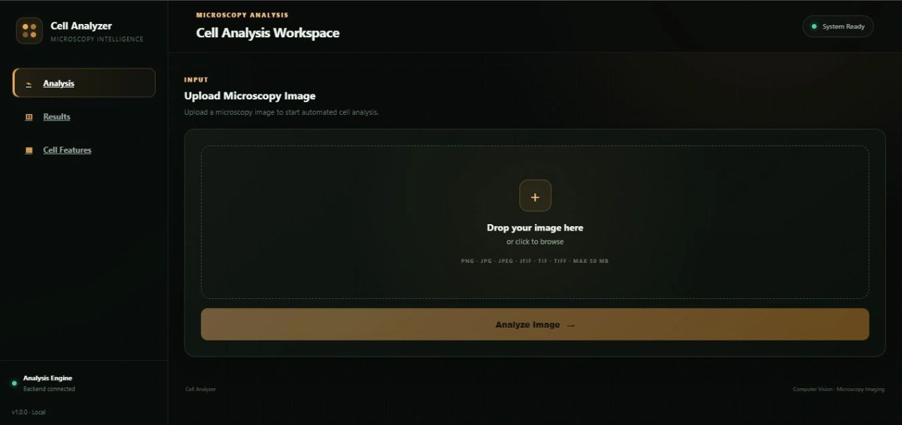
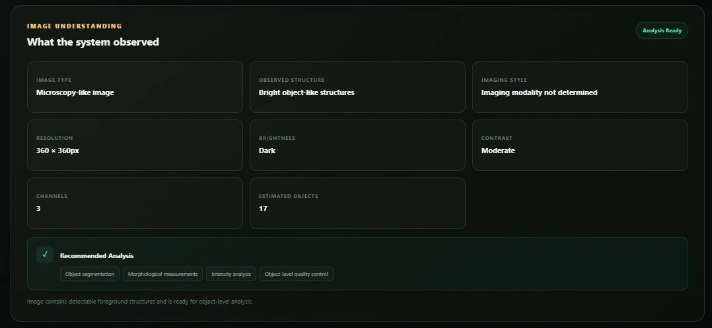
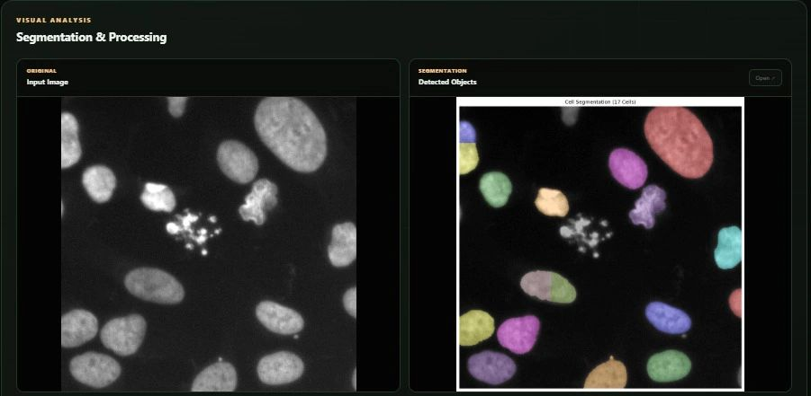
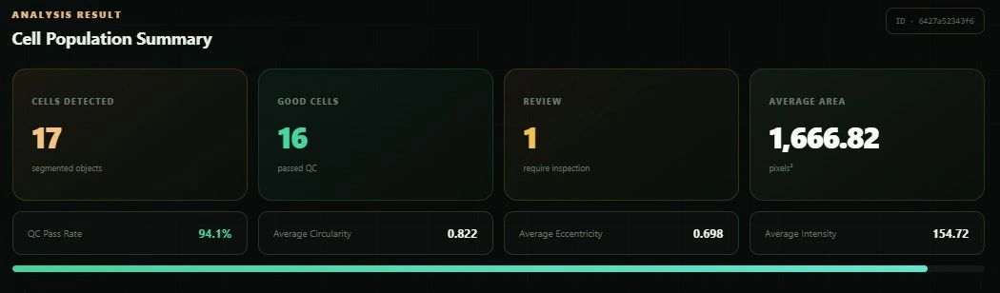
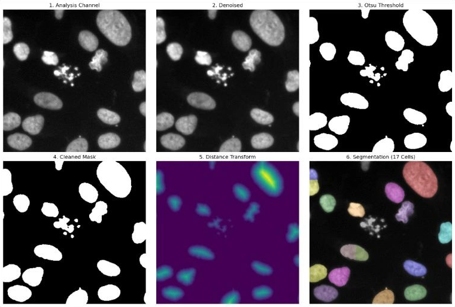
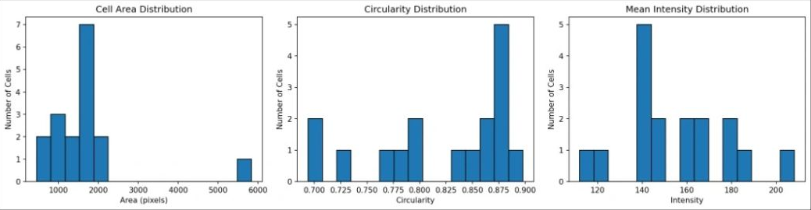
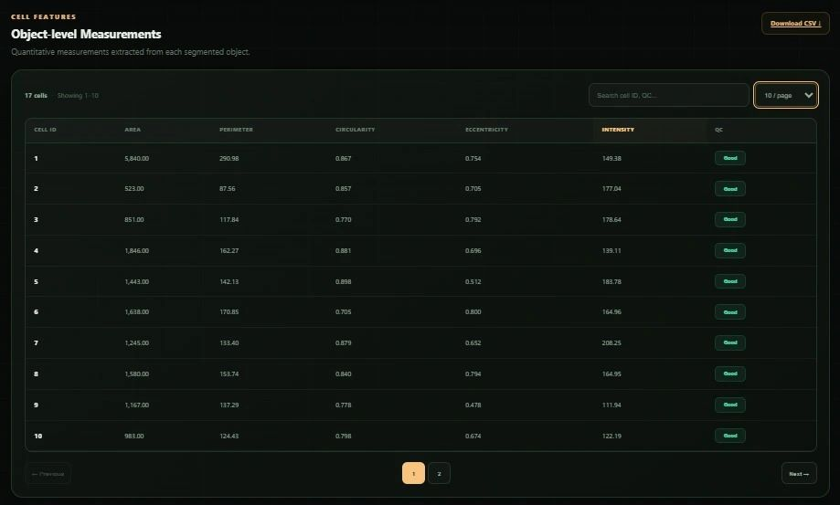

<div align="center">

# 🔬 Cell Analyzer

**An end-to-end computer vision web app for microscopy image analysis: cell/nuclei segmentation, per-cell measurements, automated quality control and CSV export.**

[](https://www.python.org/)
[](https://flask.palletsprojects.com/)
[](https://opencv.org/)
[](https://scikit-image.org/)
[](LICENSE)
[](#limitations)

### 🔗 [Try the Live Demo →](https://cell-analyzer.onrender.com)

<sub>Hosted on Render's free tier. If the app has been idle, the first load can take 30–50 seconds. After that it is fast.</sub>

[Features](#features) •
[Demo](#demo) •
[Pipeline](#computer-vision-pipeline) •
[API](#api) •
[Run locally](#run-locally) •
[Limitations](#limitations)

</div>

---

## Overview

Counting cells and measuring their shape by hand is slow, subjective and hard to reproduce. Cell Analyzer turns a raw microscopy image into structured, per-cell data in one step, through either a browser dashboard or a REST API.

Upload an image and the app will:

- describe the image (type, resolution, channels, brightness, contrast)
- segment individual cells/nuclei with a classical computer vision pipeline
- measure each object (area, perimeter, circularity, eccentricity, mean intensity)
- flag every object as `Good` or `Review` with a QC check
- show the segmentation, the pipeline stages and feature distributions
- export all measurements as a CSV file

## Features

- **Classical CV pipeline:** Otsu/adaptive threshold → morphology → distance transform → watershed
- **High-bit-depth support:** 8/12/16-bit TIFF, plus PNG, JPG/JPEG and JFIF (up to 50 MB)
- **Flask REST API** that any client can call (web UI, script or another service)
- **Browser dashboard** with searchable, paginated feature table and CSV download
- **Automated QC** to flag low-confidence objects for human review
- **Benchmark script** for comparing against annotated public datasets (BBBC039)

## Demo

**1. Upload**



**2. Image understanding**



**3. Segmentation result**



**4. Population summary**



**5. Pipeline stages**



**6. Feature distributions**



**7. Per-cell measurements (CSV export)**



### Example result

Sample image: fluorescence-style nuclei, 360 × 360 px, 3 channels.

| Metric | Value |
|---|---|
| Cells detected | 17 |
| Good / Review | 16 / 1 |
| QC pass rate | 94.1% |
| Average area | 1,666.82 px² |
| Average circularity | 0.822 |
| Average eccentricity | 0.698 |
| Average intensity | 154.72 |

First rows of the exported CSV:

| id | area | perimeter | circularity | eccentricity | mean_intensity | qc_status |
|---|---|---|---|---|---|---|
| 1 | 5,840 | 290.98 | 0.867 | 0.754 | 149.38 | Good |
| 2 | 523 | 87.56 | 0.857 | 0.705 | 177.04 | Good |
| 3 | 851 | 117.84 | 0.770 | 0.792 | 178.64 | Good |

## Architecture

```text
Browser (HTML / CSS / JS)
        │  multipart/form-data
        ▼
Flask REST API  (POST /api/analyze)
        ▼
Analysis Service
  ├── Image Understanding
  ├── Preprocessing
  ├── Segmentation
  ├── Feature Extraction
  └── Quality Control
        ▼
JSON summary + visualizations + CSV
```

The frontend only uploads the image and renders results. All image processing happens server-side, so the API stays stateless and reusable.

## Computer Vision Pipeline

| Stage | What happens |
|---|---|
| Image understanding | Detects format, bit depth, channels, brightness and contrast, and checks if the image looks analysis-ready |
| Channel selection | Picks the most informative channel |
| Intensity normalization | Rescales 8/12/16-bit data to a consistent range |
| Denoising | Gaussian smoothing to reduce noise |
| Thresholding | Otsu/adaptive threshold separates cells from background |
| Morphological cleanup | Removes small artifacts, fills holes, smooths boundaries |
| Distance transform | Distance-to-background map used to separate touching cells |
| Watershed | Splits clustered cells into individual instances |
| Feature extraction | Area, perimeter, circularity, eccentricity, mean intensity per object |
| Quality control | Labels each object `Good` or `Review` using shape/size heuristics |

## Project Structure

```text
cell_analyzer/
├── backend/
│   ├── app.py                    # Flask entrypoint (serves API + frontend)
│   ├── routes/analysis.py        # /api/analyze, /api/health
│   ├── services/analysis_service.py
│   └── core/
│       ├── preprocessing.py
│       ├── segmentation.py
│       ├── feature_extraction.py
│       └── image_understanding.py
├── frontend/                     # index.html, style.css, app.js
├── docs/screenshots/             # README images
├── benchmark.py
├── benchmark_bbbc039_fixed.py
├── requirements.txt
└── pyproject.toml
```

## API

**Health check**

```http
GET /api/health
```

```json
{ "service": "cell-analyzer", "status": "ok" }
```

**Analyze an image**

```http
POST /api/analyze
Content-Type: multipart/form-data
```

| Field | Type | Description |
|---|---|---|
| `image` | file | PNG, JPG/JPEG, JFIF or TIFF (max 50 MB) |

```python
import requests

with open("example.tif", "rb") as f:
    r = requests.post(
        "http://127.0.0.1:5000/api/analyze",
        files={"image": f},
        timeout=120,
    )

print(r.status_code)
print(r.json())
```

The response contains an analysis ID, summary metrics, image-understanding details and the generated output filenames (visualizations and CSV).

## Run locally

```bash
git clone https://github.com/Sohel123-png/cell_analyzer.git
cd cell_analyzer

python -m venv .venv
# Windows PowerShell:  .venv\Scripts\Activate.ps1
# macOS / Linux:       source .venv/bin/activate

python -m pip install -r requirements.txt
python -m backend.app
```

Open `http://127.0.0.1:5000/`. To verify the API:

```bash
python -c "import requests; print(requests.get('http://127.0.0.1:5000/api/health').json())"
```

## Benchmarking

`benchmark_bbbc039_fixed.py` evaluates segmentation against the public BBBC039 dataset. The dataset is not included in this repo, so download it separately and place it in the local benchmark folders.

```bash
python benchmark_bbbc039_fixed.py `
  --images "benchmarks\manual_tests\images_raw\images" `
  --masks "benchmarks\manual_tests\masks_raw\masks" `
  --output outputs\bbbc039_test.csv
```

> The predictions are currently derived from the rendered segmentation image, not from a raw instance-label output. Treat the numbers as preliminary engineering metrics, not validated accuracy.

## Technologies

- **Backend:** Python, Flask, OpenCV, NumPy, SciPy, scikit-image, Pandas
- **Frontend:** HTML5, CSS3, vanilla JavaScript
- **CV techniques:** Otsu/adaptive thresholding, morphology, Euclidean distance transform, watershed, connected-component analysis

## Limitations

This is a portfolio/engineering project, not a validated scientific or clinical tool.

- Segmentation quality depends on staining, illumination, cell density and image quality.
- It uses classical CV, not a trained deep-learning model. In the sample above, one elongated nucleus is split into two segments and a cluster of small bright fragments is not segmented.
- Image-understanding labels (such as "microscopy-like") are heuristic.
- Objects marked `Review` should be checked by a human.
- Benchmark metrics are preliminary (see above).

## Roadmap

- [ ] Raw instance-mask output from the backend for rigorous benchmarking
- [ ] IoU-based instance matching (precision / recall)
- [ ] Modality-aware preprocessing (brightfield, fluorescence, phase contrast)
- [ ] Deep-learning backend (U-Net / Cellpose)
- [ ] Batch processing for multiple images
- [ ] Docker deployment

## Contributing

Issues and pull requests are welcome. Fork the repo, create a branch (`git checkout -b feature/my-feature`), commit, push and open a pull request. Good first areas: Docker packaging, batch upload, better benchmark metrics, and a deep-learning segmentation backend.

If you find the project useful, a ⭐ helps others discover it.

## Author

**Sohel Ali**: [GitHub](https://github.com/Sohel123-png) · [LinkedIn](https://www.linkedin.com/in/sohel-ali-6435253a8/) · sayyedsohelali448@gmail.com

## License

Released under the [MIT License](LICENSE).
